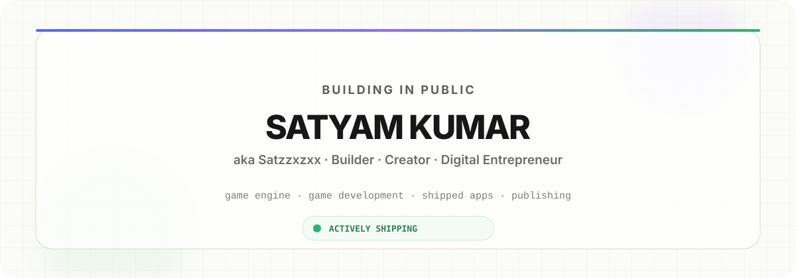
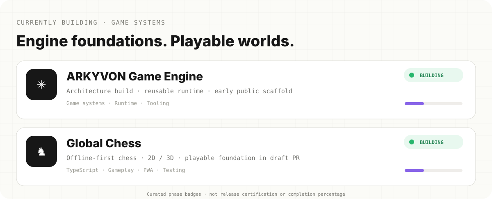
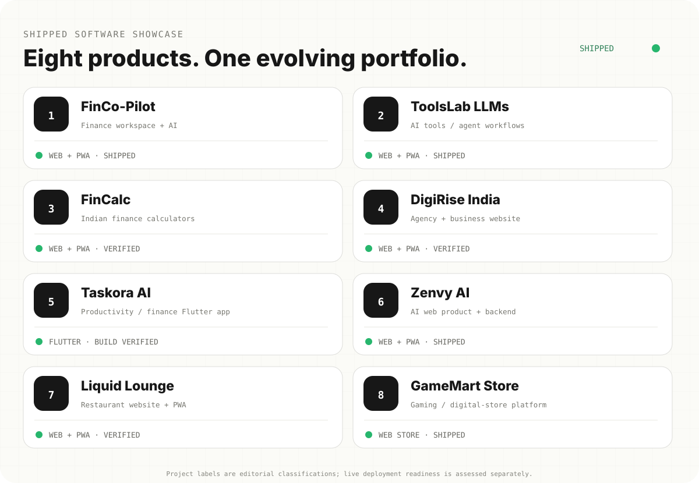
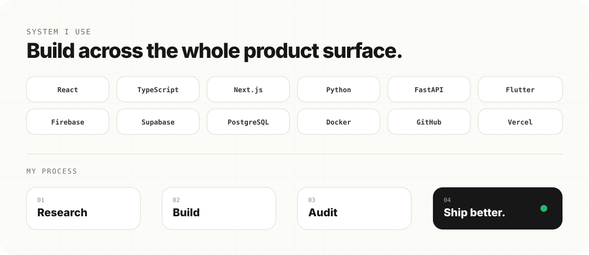

 

 

  

 

## `01` About the builder

I’m **Satyam Kumar**, also known as **Satzzxzxx** — a builder, creator, and digital entrepreneur working across **AI tools, finance products, game systems, creator utilities, productivity apps, business websites, and digital growth systems**.

I care more about **useful work, shipped products, and visible progress** than loud claims. My working loop is simple: understand the problem, build the product, audit it hard, then ship a better version.

I also build and grow **DigiRise India**, while continuously experimenting with products of my own.

<table>
<tr>
<td width="25%" align="center"><!-- PROFILE_TRACKED_COUNT_START -->
<b>58</b>
<!-- PROFILE_TRACKED_COUNT_END --> tracked repositories public live + private audit</td>
<td width="25%" align="center"><b>2</b> primary products in the hero showcase</td>
<td width="25%" align="center"><b>6</b> shipped products highlighted</td>
<td width="25%" align="center"><b>Web · Mobile · AI</b> core product surface</td>
</tr>
</table>

> Current-first profile: real product state, real repository signals, and generated activity surfaces instead of stale vanity metrics.

 

---

 

## `02` Currently building

### **FinCo-Pilot** — personal finance + AI platform

Privacy-first finance cockpit for accounts, transactions, imports, categorization, budgets, goals, reports, shared expenses, invoices, multi-currency, bank integrations, backup/restore, and optional AI workflows.

`React` · `TypeScript` · `Vite` · `FastAPI` · `PostgreSQL` · `Redis` · `Celery` · `Docker` · `AI/MCP/RAG`

**Current phase:** production hardening, audit, polish, and release preparation.  
**Repository:** [`S2zxx0zxx/FinCo-pilot`](https://github.com/S2zxx0zxx/FinCo-pilot)

### **ToolsLab LLMs** — practical LLM product lab

AI/LLM product focused on useful model-powered tools, agent workflows, research utilities, and practical automation. The public codebase currently lives under **Toolshub** while the product identity evolves toward ToolsLab LLMs.

`LLMs` · `Agents` · `AI workflows` · `Web tools` · `Product systems`

**Current phase:** active product development and launch-readiness cleanup.  
**Repository:** [`S2zxx0zxx/Toolshub`](https://github.com/S2zxx0zxx/Toolshub)

 

The heartbeat board is generated from public repository metadata and latest commit signals. Product phase labels remain curated so automation never invents release state.

 

### Engineering frontier · games, engine & creator infrastructure

The original two-product showcase stays intact. This is an additive, evidence-based view of the newer engineering work.

<table>
<tr>
<td width="50%" valign="top">

<h4>ARKYVON · Game Engine</h4>

New game-engine identity and architecture R&amp;D. The public repository currently contains a starter README, not a functional engine release.

</td>
<td width="50%" valign="top">

<h4>Global Chess · 2D / 3D</h4>

Offline-first chess foundation, interactive 2D/3D work and device-focused QA. Core implementation is in a draft pull request; production acceptance is still pending.

</td>
</tr>
<tr>
<td width="50%" valign="top">

<h4>LiveClip Zero Studio</h4>

Local-first livestream capture and evidence-ranked video highlight tooling with desktop and private localhost browser workflows. Semantic highlight accuracy remains unverified.

</td>
<td width="50%" valign="top">

<h4>OpenXdrive · Storage Gateway</h4>

Multi-account Google Drive and S3-compatible storage dashboard, upload routing and API workflows. Repository functionality is documented; production deployment is not claimed.

</td>
</tr>
</table>

<b>More additions to the public engineering universe</b>

- [Satzzxzxx Labs](https://github.com/S2zxx0zxx/Satzzxzxx-Labs) — technology studio and engineering publication
- [FinCoPilot.App](https://github.com/S2zxx0zxx/Fincopilot.App) — FinCo-Pilot public product documentation and explainer site
- [Arcovia adaptation](https://github.com/S2zxx0zxx/arcovia-S2zzx0zxx) — architecture tooling; retain upstream licensing and attribution
- [Global Carrom](https://github.com/S2zxx0zxx/Global-Carrom-Online-PVP-) — initial repository scaffold
- [Global Brain / IQ Puzzle](https://github.com/S2zxx0zxx/Global-Brain-Iq-Train-Puzzle) — initial repository scaffold

Project stages are curated, not inferred from stars, commit volume, or a README claim. Ongoing engine research is not represented as a released engine.

 

---

 

## `03` Shipped products

<table>
<tr>
<td width="50%" valign="top">

### **FinCalc**
Indian finance calculator platform built around practical money calculations, finance content, SEO, and a lightweight public web experience.

[`Public repository`](https://github.com/S2zxx0zxx/financeCalculator-Ind-v6.0-)

</td>
<td width="50%" valign="top">

### **DigiRise India**
Business and digital-agency platform for services, content, work, brand presence, and growth-oriented web experiences.

[`Public repository`](https://github.com/S2zxx0zxx/DigiRise-India)

</td>
</tr>
<tr>
<td width="50%" valign="top">

### **Taskora AI**
Flutter productivity app spanning tasks, groceries, expenses, calculator workflows, local persistence, and AI-oriented utilities.

`Private product · build/test evidence documented`

</td>
<td width="50%" valign="top">

### **Zenvy AI**
AI-focused web product with a dedicated backend, PWA support, deployment configuration, and a focused product experience.

[`Public repository`](https://github.com/S2zxx0zxx/Zenvy-AI)

</td>
</tr>
<tr>
<td width="50%" valign="top">

### **Liquid Lounge**
Polished personal/static web experience with PWA capabilities, service-worker support, custom-domain plumbing, and clean deployment architecture.

[`Public repository`](https://github.com/S2zxx0zxx/liquid-lounge)

</td>
<td width="50%" valign="top">

### **GameMart Store**
Gaming and digital-store product focused on a direct, product-first shopping experience.

`Private product`

</td>
</tr>
</table>

 

---

 

## `04` Featured five

| Rank | Product | What it represents | Current state |
|:--:|---|---|---|
| **01** | **FinCo-Pilot** | Full-stack personal finance + AI system | 🟢 Building / hardening |
| **02** | **FitTrackAI** | AI fitness & nutrition product | ✅ Build + tests documented |
| **03** | **ToolsLab LLMs / Toolshub** | Multi-tool AI / LLM product system | 🟢 Building |
| **04** | **DigiRise India** | Real business / agency web platform | ✅ Shipped |
| **05** | **FinCalc** | Finance tools + content platform | ✅ Shipped |

FitTrackAI is private, so this profile describes it without exposing private source.

 

---

 

## `05` Product universe

The constellation groups **public repositories** into product domains and highlights current flagship signals. Private repositories are not enumerated here; the profile-level count stays separate.

<!-- PROFILE_REPO_CATALOG_START -->

<b>Explore all 47 public repositories</b> · auto-synced repository index

Public metadata only · grouped by area · dates indicate repository activity, not product releases. Private repository names are not disclosed.

<table>
<tr><th align="left">Repository</th><th align="left">Area</th><th align="left">Last push</th><th align="left">About</th></tr>
<tr><td><a href="https://github.com/S2zxx0zxx/ARKYVON"><b>ARKYVON</b></a></td><td>GAME / ENGINE</td><td>—</td><td>Repository scaffold</td></tr>
<tr><td><a href="https://github.com/S2zxx0zxx/GameMartStudios"><b>GameMartStudios</b></a></td><td>GAME / ENGINE</td><td>—</td><td>Public repository</td></tr>
<tr><td><a href="https://github.com/S2zxx0zxx/Global-Brain-Iq-Train-Puzzle"><b>Global-Brain-Iq-Train-Puzzle</b></a></td><td>GAME / ENGINE</td><td>—</td><td>Repository scaffold</td></tr>
<tr><td><a href="https://github.com/S2zxx0zxx/Global-Carrom-Online-PVP-"><b>Global-Carrom-Online-PVP-</b></a></td><td>GAME / ENGINE</td><td>—</td><td>Repository scaffold</td></tr>
<tr><td><a href="https://github.com/S2zxx0zxx/Global-Chess-Online-PVP-"><b>Global-Chess-Online-PVP-</b></a></td><td>GAME / ENGINE</td><td>—</td><td>Public repository</td></tr>
<tr><td><a href="https://github.com/S2zxx0zxx/bribes-fyi"><b>bribes-fyi</b></a></td><td>FINANCE</td><td>—</td><td>Public repository</td></tr>
<tr><td><a href="https://github.com/S2zxx0zxx/financeCalculator-Ind-v6.0-"><b>financeCalculator-Ind-v6.0-</b></a></td><td>FINANCE</td><td>—</td><td>Public repository</td></tr>
<tr><td><a href="https://github.com/S2zxx0zxx/Fincopilot.App"><b>Fincopilot.App</b></a></td><td>FINANCE</td><td>—</td><td>Public repository</td></tr>
<tr><td><a href="https://github.com/S2zxx0zxx/Flight-Fare-Prediction-Tool"><b>Flight-Fare-Prediction-Tool</b></a></td><td>FINANCE</td><td>—</td><td>Public repository</td></tr>
<tr><td><a href="https://github.com/S2zxx0zxx/MarketTrade-Insight-Ai"><b>MarketTrade-Insight-Ai</b></a></td><td>FINANCE</td><td>—</td><td>Public repository</td></tr>
<tr><td><a href="https://github.com/S2zxx0zxx/Airbnb-Price-Prediction-Software"><b>Airbnb-Price-Prediction-Software</b></a></td><td>AI</td><td>—</td><td>Public repository</td></tr>
<tr><td><a href="https://github.com/S2zxx0zxx/Bharat-OS"><b>Bharat-OS</b></a></td><td>AI</td><td>—</td><td>Public repository</td></tr>
<tr><td><a href="https://github.com/S2zxx0zxx/BuildmeAi-By-Arunav-Mehta-"><b>BuildmeAi-By-Arunav-Mehta-</b></a></td><td>AI</td><td>—</td><td>Public repository</td></tr>
<tr><td><a href="https://github.com/S2zxx0zxx/codebase-memory-mcp-Satzzxzxx"><b>codebase-memory-mcp-Satzzxzxx</b></a></td><td>AI</td><td>—</td><td>Public repository</td></tr>
<tr><td><a href="https://github.com/S2zxx0zxx/Multi-Ai-Agent-Blog-Generation"><b>Multi-Ai-Agent-Blog-Generation</b></a></td><td>AI</td><td>—</td><td>Public repository</td></tr>
<tr><td><a href="https://github.com/S2zxx0zxx/Spam-Email-Detection-Software"><b>Spam-Email-Detection-Software</b></a></td><td>AI</td><td>—</td><td>Public repository</td></tr>
<tr><td><a href="https://github.com/S2zxx0zxx/Toolshub"><b>Toolshub</b></a></td><td>AI</td><td>—</td><td>Public repository</td></tr>
<tr><td><a href="https://github.com/S2zxx0zxx/Zenvy-AI"><b>Zenvy-AI</b></a></td><td>AI</td><td>—</td><td>Public repository</td></tr>
<tr><td><a href="https://github.com/S2zxx0zxx/Music-Photo.Studio"><b>Music-Photo.Studio</b></a></td><td>CREATOR TOOLS</td><td>—</td><td>Public repository</td></tr>
<tr><td><a href="https://github.com/S2zxx0zxx/Unlimited-Auto-Cut-Clipper-Tool"><b>Unlimited-Auto-Cut-Clipper-Tool</b></a></td><td>CREATOR TOOLS</td><td>—</td><td>Public repository</td></tr>
<tr><td><a href="https://github.com/S2zxx0zxx/arcovia-S2zzx0zxx"><b>arcovia-S2zzx0zxx</b></a></td><td>ENGINEERING</td><td>—</td><td>Public repository</td></tr>
<tr><td><a href="https://github.com/S2zxx0zxx/OpenXdrive"><b>OpenXdrive</b></a></td><td>ENGINEERING</td><td>—</td><td>Public repository</td></tr>
<tr><td><a href="https://github.com/S2zxx0zxx/Satzzxzxx-Labs"><b>Satzzxzxx-Labs</b></a></td><td>STUDIO</td><td>—</td><td>Public repository</td></tr>
<tr><td><a href="https://github.com/S2zxx0zxx/BEPb"><b>BEPb</b></a></td><td>SYSTEMS</td><td>—</td><td>Public repository</td></tr>
<tr><td><a href="https://github.com/S2zxx0zxx/BT"><b>BT</b></a></td><td>SYSTEMS</td><td>—</td><td>Public repository</td></tr>
<tr><td><a href="https://github.com/S2zxx0zxx/OmniRoute-Satzzxzxx"><b>OmniRoute-Satzzxzxx</b></a></td><td>SYSTEMS</td><td>—</td><td>Public repository</td></tr>
<tr><td><a href="https://github.com/S2zxx0zxx/DigiRise-Admin-beta-"><b>DigiRise-Admin-beta-</b></a></td><td>BUSINESS</td><td>—</td><td>Public repository</td></tr>
<tr><td><a href="https://github.com/S2zxx0zxx/DigiRise-Brands"><b>DigiRise-Brands</b></a></td><td>BUSINESS</td><td>—</td><td>Public repository</td></tr>
<tr><td><a href="https://github.com/S2zxx0zxx/DigiRise-India"><b>DigiRise-India</b></a></td><td>BUSINESS</td><td>—</td><td>Public repository</td></tr>
<tr><td><a href="https://github.com/S2zxx0zxx/DigiRise-Portfolio"><b>DigiRise-Portfolio</b></a></td><td>BUSINESS</td><td>—</td><td>Public repository</td></tr>
<tr><td><a href="https://github.com/S2zxx0zxx/Growpartner-Satzzxzxx"><b>Growpartner-Satzzxzxx</b></a></td><td>BUSINESS</td><td>—</td><td>Public repository</td></tr>
<tr><td><a href="https://github.com/S2zxx0zxx/CamPhish-Developers-Only-"><b>CamPhish-Developers-Only-</b></a></td><td>WEB</td><td>—</td><td>Public repository</td></tr>
<tr><td><a href="https://github.com/S2zxx0zxx/Comparemobiles"><b>Comparemobiles</b></a></td><td>WEB</td><td>—</td><td>Public repository</td></tr>
<tr><td><a href="https://github.com/S2zxx0zxx/elitehub"><b>elitehub</b></a></td><td>WEB</td><td>—</td><td>Public repository</td></tr>
<tr><td><a href="https://github.com/S2zxx0zxx/liquid-lounge"><b>liquid-lounge</b></a></td><td>WEB</td><td>—</td><td>Public repository</td></tr>
<tr><td><a href="https://github.com/S2zxx0zxx/S2zxx0zxx"><b>S2zxx0zxx</b></a></td><td>WEB</td><td>—</td><td>Public repository</td></tr>
<tr><td><a href="https://github.com/S2zxx0zxx/S2zxx0zxx.github.io"><b>S2zxx0zxx.github.io</b></a></td><td>WEB</td><td>—</td><td>Public repository</td></tr>
<tr><td><a href="https://github.com/S2zxx0zxx/satzxzxx.github.io"><b>satzxzxx.github.io</b></a></td><td>WEB</td><td>—</td><td>Public repository</td></tr>
<tr><td><a href="https://github.com/S2zxx0zxx/Satzzxzxx"><b>Satzzxzxx</b></a></td><td>WEB</td><td>—</td><td>Public repository</td></tr>
<tr><td><a href="https://github.com/S2zxx0zxx/scenicone"><b>scenicone</b></a></td><td>WEB</td><td>—</td><td>Public repository</td></tr>
<tr><td><a href="https://github.com/S2zxx0zxx/TravelTogether-v19"><b>TravelTogether-v19</b></a></td><td>WEB</td><td>—</td><td>Public repository</td></tr>
<tr><td><a href="https://github.com/S2zxx0zxx/Docxify"><b>Docxify</b></a></td><td>LEARN</td><td>—</td><td>Public repository</td></tr>
<tr><td><a href="https://github.com/S2zxx0zxx/Git-track"><b>Git-track</b></a></td><td>LEARN</td><td>—</td><td>Public repository</td></tr>
<tr><td><a href="https://github.com/S2zxx0zxx/Image-Scraping-Advanced-2.0.1"><b>Image-Scraping-Advanced-2.0.1</b></a></td><td>LEARN</td><td>—</td><td>Public repository</td></tr>
<tr><td><a href="https://github.com/S2zxx0zxx/Leetcode-Solutions"><b>Leetcode-Solutions</b></a></td><td>LEARN</td><td>—</td><td>Public repository</td></tr>
<tr><td><a href="https://github.com/S2zxx0zxx/VsCode-Satzzxzxx"><b>VsCode-Satzzxzxx</b></a></td><td>LEARN</td><td>—</td><td>Public repository</td></tr>
<tr><td><a href="https://github.com/S2zxx0zxx/Web-Article-Scrapping-Tool"><b>Web-Article-Scrapping-Tool</b></a></td><td>LEARN</td><td>—</td><td>Public repository</td></tr>
</table>

<!-- PROFILE_REPO_CATALOG_END -->

Inventory checkpoint (22 Nov 2026): 47 public repositories + 11 private repositories = 58 tracked. The public index is refreshed by the existing six-hour workflow when GitHub Actions runs. Private repo totals require a separate authenticated audit; repository-scoped automation cannot detect new private repositories automatically.

 

---

 

## `06` System & shipping loop

### Core product stack

 

- **Frontend / product UI:** React, TypeScript, Next.js, Vite, Flutter
- **Backend / APIs:** Python, FastAPI, serverless functions, API-oriented services
- **Data / auth:** PostgreSQL, Firebase, Supabase
- **Infra / delivery:** Docker, GitHub Actions, Vercel, GitHub Pages
- **AI:** LLM integration, agent workflows, MCP/RAG experiments, model-powered utilities
- **Product growth:** SEO, content systems, analytics thinking, business positioning

 

 

---

 

## `07` Learning in public

I use real projects as the classroom. The areas I’m deliberately improving right now are:

<table>
<tr>
<td width="20%" align="center"><b>AI Agents</b> LLM systems & workflows</td>
<td width="20%" align="center"><b>Backend</b> scalable product architecture</td>
<td width="20%" align="center"><b>Security</b> hardening & launch safety</td>
<td width="20%" align="center"><b>Product Design</b> UI, motion, hierarchy</td>
<td width="20%" align="center"><b>SEO & Growth</b> discovery & distribution</td>
</tr>
</table>

### `Research → Build → Audit → Ship`

**Research deeply. Build fast. Audit hard. Ship better.**

A project is not “done” because the UI looks finished — it needs to survive testing, architecture review, security checks, edge cases, real deployment, and user feedback.

 

---

 

## `08` More from the lab

<b>AI / product experiments</b>

 

- [`Bharat-OS`](https://github.com/S2zxx0zxx/Bharat-OS)
- [`bribes-fyi`](https://github.com/S2zxx0zxx/bribes-fyi)
- [`elitehub`](https://github.com/S2zxx0zxx/elitehub)
- [`OmniRoute-Satzzxzxx`](https://github.com/S2zxx0zxx/OmniRoute-Satzzxzxx)
- [`codebase-memory-mcp-Satzzxzxx`](https://github.com/S2zxx0zxx/codebase-memory-mcp-Satzzxzxx)

<b>Web / business / creative builds</b>

 

- [`DigiRise-Portfolio`](https://github.com/S2zxx0zxx/DigiRise-Portfolio)
- [`DigiRise-Admin-beta-`](https://github.com/S2zxx0zxx/DigiRise-Admin-beta-)
- [`Growpartner-Satzzxzxx`](https://github.com/S2zxx0zxx/Growpartner-Satzzxzxx)
- [`TravelTogether-v19`](https://github.com/S2zxx0zxx/TravelTogether-v19)
- [`scenicone`](https://github.com/S2zxx0zxx/scenicone)

<b>Learning / utility repositories</b>

 

- [`Leetcode-Solutions`](https://github.com/S2zxx0zxx/Leetcode-Solutions)
- [`MarketTrade-Insight-Ai`](https://github.com/S2zxx0zxx/MarketTrade-Insight-Ai)
- [`Flight-Fare-Prediction-Tool`](https://github.com/S2zxx0zxx/Flight-Fare-Prediction-Tool)
- [`Spam-Email-Detection-Software`](https://github.com/S2zxx0zxx/Spam-Email-Detection-Software)
- [`Image-Scraping-Advanced-2.0.1`](https://github.com/S2zxx0zxx/Image-Scraping-Advanced-2.0.1)

 

---

 

## `09` How I think about building

<table>
<tr>
<td width="33%" valign="top">

### Useful > impressive
A small product solving a real problem is more valuable than a complicated system built only to look advanced.

</td>
<td width="33%" valign="top">

### Evidence > claims
Build results, tests, deployment, audits, and actual product behavior matter more than a long technology list.

</td>
<td width="33%" valign="top">

### Iteration > perfection
Ship a solid version, inspect what breaks, learn from it, then make the next version meaningfully better.

</td>
</tr>
</table>

 

---

 

## `10` Live shipping signals

Generated from latest public commits across selected flagship repositories and sorted newest-first. The live system is scheduled every six hours and only commits generated assets when the underlying signal changes.

 

---

 

## `11` Contribution trail

Two views of the same real activity: the snake consumes the grid; the skyline turns daily contribution intensity into height.

  

<picture>
  <source media="(prefers-color-scheme: dark)" srcset="https://raw.githubusercontent.com/S2zxx0zxx/S2zxx0zxx/output/github-contribution-grid-snake-dark.svg" />
  <source media="(prefers-color-scheme: light)" srcset="https://raw.githubusercontent.com/S2zxx0zxx/S2zxx0zxx/output/github-contribution-grid-snake.svg" />
  
</picture>

 

  

 

---

 

## `12` Find me

**Satyam Kumar · Satzzxzxx**  
Builder · Creator · Digital Entrepreneur

 

  

 

Warm minimal UI · real signals · honest product state · motion with purpose.

